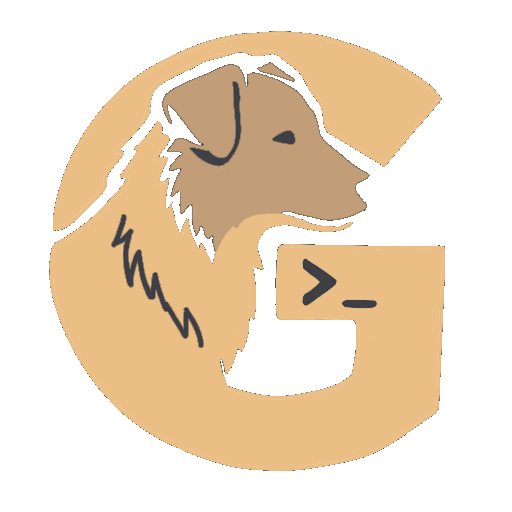
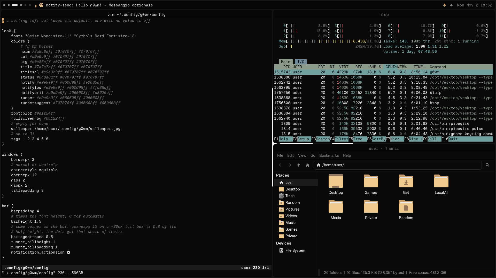
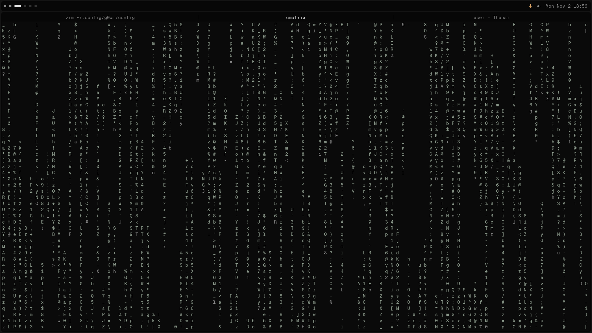

<div align="center">
  

# G0 Window Manager

**The Wayland compositor that wants to be a desktop environment**

**[<kbd> <br> Features <br> </kbd>][Features]** 
**[<kbd> <br> Install <br> </kbd>][Install]** 
**[<kbd> <br> Build <br> </kbd>][Build]** 
**[<kbd> <br> Configure <br> </kbd>][Configure]** 
**[<kbd> <br> Release <br> </kbd>][Release]**

</div>


----


G0wm is a Wayland compositor that tries to be a complete desktop environment.
A lot of features are built in, so you need fewer external programs, and there
are some privacy options too. It started as a fork of [dwl](https://codeberg.org/dwl/dwl),
but most of it has changed since.

**Privacy:** you can hide windows with a keybind. They stay visible to you, but when
you share your screen (on Discord, for example) the others can't see their content
or title. Same goes for notifications.

**Bar:** the built-in bar handles workspaces, status, notifications and the runner.
The status text comes from a script, like in other compositors. The runner opens
with a keybind and launches apps from their `.desktop` files. Prefixes change what
it does: search the web, do calculations or run a binary directly in a terminal.
Notifications support images, urgency and history.

**Title bars & tabbed:** title bars are on by default. Besides looking nice, they're
what the tabbed mode uses, like in sway and i3.

**Looks:** you can configure borders borders, background, style, window colors,
blur and more.

More in [docs/features.md](docs/features.md).

## Install

Grab a package from the [latest release][Release] (x86_64, wlroots and libscfg included):

```sh
sudo apt install ./g0wm_*_amd64.deb                            # Ubuntu 26.04+, Debian testing
sudo dnf install ./g0wm-*.x86_64.rpm                           # Fedora 44+
sudo zypper install --allow-unsigned-rpm ./g0wm-*.x86_64.rpm   # openSUSE Tumbleweed
sudo tar -xzf g0wm-*.tar.gz -C /                               # others, no dependency check
```

Older distros (Debian 13, Ubuntu 24.04, Fedora 43) lack wlroots 0.20, so build from source.
To check the download: `sha256sum -c --ignore-missing SHA256SUMS`.

## Build

Needs wlroots 0.20 (libinput backend), wayland, wayland-protocols, libinput,
xkbcommon, pixman, fcft, libdbus, gdk-pixbuf, [libscfg](https://git.sr.ht/~emersion/scfg),
pkg-config and GCC 14+ or Clang 18+. For X11 apps also libxcb, xcb-icccm and Xwayland.

```sh
./configure && make
make install                                    # installs to ~/.local/bin
```

If wlroots or libscfg aren't packaged on your distro:

```sh
./configure --wlroots-prefix=/path/to/prefix    # use your own build (rpath is set)
./configure --bundle-deps                       # or fetch and link them statically (needs git, meson, ninja)
```

Rerun `./configure` when you change build options or update the script.
`make V=1` shows the commands; `make help` lists the targets. `make check`
runs the config tests, clang-format and ShellCheck (the last two must be installed).

`--native` adds `-O3`, CPU tuning and LTO. Hardening is a separate option,
`--enable-hardening`; use both for the old `--native` behavior. Debug builds
skip `_FORTIFY_SOURCE`.

Other options: `./configure --help`.

## Configure & Run

The config lives in `~/.config/g0wm/config` ([all settings](docs/settings.md)).
`make install` creates it, or run `g0wm -c` to write a default one.

Start g0wm from your display manager or a TTY. The status text is read from stdin:

```sh
your-status-script | g0wm
```

With `make install`, the session file goes to `~/.local/share/wayland-sessions/`,
which most display managers ignore. Copy `share/g0wm.desktop` to
`/usr/share/wayland-sessions/` if g0wm doesn't show up.

## Screenshots

<details>
<summary>Show screenshots</summary>




</details>

## License

GPL-3.0-or-later, see [`LICENSE`](LICENSE). Code from dwl and other projects keeps
its original license (every file says which, following [REUSE](https://reuse.software)).
Credits and patch authors are in [docs/credits.md](docs/credits.md).

[Features]: docs/features.md
[Install]: #install
[Build]: #build
[Configure]: docs/settings.md
[Release]: https://github.com/frapank/G0wm/releases/latest
