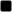
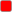
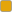
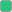
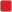
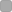
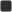
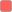
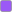

<h1 align="center">Settings</h1>

<p align="center">
  Every setting of g0wm, its default and what it does.
</p>

<div align="center">

**[<kbd> <br> File format <br> </kbd>](#file-format)** 
**[<kbd> <br> look <br> </kbd>](#look)** 
**[<kbd> <br> windows <br> </kbd>](#windows)** 
**[<kbd> <br> bar <br> </kbd>](#bar)** 
**[<kbd> <br> opacity <br> </kbd>](#opacity)** 
**[<kbd> <br> input <br> </kbd>](#input)** 
**[<kbd> <br> misc <br> </kbd>](#misc)**

**[<kbd> <br> layout <br> </kbd>](#layout)** 
**[<kbd> <br> rule <br> </kbd>](#rule)** 
**[<kbd> <br> monitor <br> </kbd>](#monitor)** 
**[<kbd> <br> autostart <br> </kbd>](#autostart)** 
**[<kbd> <br> Bindings <br> </kbd>](#bindings)** 
**[<kbd> <br> Actions <br> </kbd>](#actions)** 
**[<kbd> <br> Default bindings <br> </kbd>](#default-bindings)**

</div>

---

## File format

Everything lives in one file, `~/.config/g0wm/config` (or
`$XDG_CONFIG_HOME/g0wm/config` if you set that variable). It's an
[scfg](https://git.sr.ht/~emersion/scfg) file, so it's pretty simple. Each line
is a setting followed by its value, blocks go between `{ }` and anything after
a `#` is a comment.

```scfg
look {
	fonts "JetBrains Mono:size=11"
}

windows {
	borderpx 2
	gappx 6
}
```

| Value | Written as |
| --- | --- |
| Boolean | `true` or `false` |
| Number | `4`, `0.55`, `-1` |
| Color | `#rrggbbaa` |
| String | `word`, or `"with spaces"` between quotes |
| List | several words on the same line |

- Run `g0wm -c` to get a file with all the defaults. If you already have one,
  it won't touch it and just prints the settings g0wm is using.
- You don't need to write every setting. Anything you leave out keeps its
  default. A text setting with no value is turned off.
- If you make a typo, use the wrong kind of value or write a setting twice,
  g0wm tells you on stderr with the line number. Everything else in the file
  still works.

> [!TIP]
> Press <kbd>Super</kbd> + <kbd>Shift</kbd> + <kbd>R</kbd> to reload the file
> without restarting g0wm.

> [!NOTE]
> Touchpad and other device settings are only picked up when the device is
> plugged in, so for those you need to restart g0wm.

---

## look

Fonts, colors and tags.

<!--
<p align="center">
  <picture>
    <source media="(prefers-color-scheme: dark)" srcset="../.github/assets/look-dark.png">
    
  </picture>
</p>
-->

| Setting | Default | Description |
| --- | --- | --- |
| `fonts` | `monospace:size=10` | Fonts for the bar and the title bars. If the first one is missing a character, the next ones are tried. |
| `colors` | | Color schemes, see [colors](#colors). |
| `rootcolor` |  `#000000ff` | Background color when there is no wallpaper. |
| `fullscreen_bg` |  `#000000ff` | Color behind a fullscreen window smaller than the output. |
| `wallpaper` <sup>integrated background</sup> | empty | Path of the wallpaper image. Empty for none. |
| `tags` | `1` to `9` | Names of the tags, in order. At most 31 are used. |

The ones marked <sup>integrated background</sup> are only there if g0wm was
built with the integrated background.

### colors

Each scheme takes three colors: text, background and border.

```scfg
look {
	colors {
		norm #ffffffff #000000ff #000000ff
		sel  #ffffffff #000000ff #005577ff
	}
}
```

| Scheme | Used for | Default (fg · bg · border) |
| --- | --- | --- |
| `norm` | Bar, tags and unfocused window borders |  `#ffffffff` ·  `#000000ff` ·  `#000000ff` |
| `sel` | Selected tag and focused window border |  `#ffffffff` ·  `#000000ff` ·  `#000000ff` |
| `urg` | Urgent tags and windows |  `#ffffffff` ·  `#000000ff` ·  `#ff0000ff` |
| `title` | Title bar of an unfocused window |  `#888888ff` ·  `#000000ff` ·  `#000000ff` |
| `titlesel` | Title bar of the focused window |  `#ffffffff` ·  `#000000ff` ·  `#000000ff` |
| `status` | Status text |  `#ffffffff` ·  `#000000ff` ·  `#000000ff` |
| `notify` | Notifications, normal urgency |  `#000000ff` ·  `#ffffffff` ·  `#e5a50aff` |
| `notifylow` | Notifications, low urgency |  `#000000ff` ·  `#ffffffff` ·  `#2ec27eff` |
| `notifycrit` | Notifications, critical urgency |  `#000000ff` ·  `#ffffffff` ·  `#e01b24ff` |
| `runner` | Runner prompt |  `#ffffffff` ·  `#000000ff` ·  `#000000ff` |
| `runnersuggest` | Runner suggestion and placeholder |  `#aaaaaaff` ·  `#000000ff` ·  `#000000ff` |
| `runnersel` | Selected runner entry |  `#000000ff` ·  `#ffffffff` ·  `#000000ff` |
| `runnericon` | Stand-in for a missing runner icon |  `#ffffffff` ·  `#2e2e2eff` ·  `#4a4a4aff` |

For notifications, the border color is the little urgency line.

---

## windows

Borders, gaps and title bars.

| Setting | Default | Description |
| --- | --- | --- |
| `borderpx` | `1` | Border width, in pixels. |
| `cornerstyle` | `normal` | Shape of the corners: `normal` or `squircle`. |
| `cornerpx` | `0` | Corner radius, in pixels. `0` for square corners. |
| `gaps` | `1` | Whether the gaps are on at startup. Toggled with `togglegaps`. |
| `gappx` | `3` | Gap size, in pixels. |
| `smartgaps` | `false` | No gaps when there is only one window. |
| `titlebar` | `true` | Show a title bar on the windows. Toggled with `toggletitlebar`. |
| `titlepadding` | `6` | Extra height of the title bar, in pixels. |
| `titlecenter` | `true` | Center the title text. |
| `titleclose` | `true` | Show a close button on the title bar while the pointer is over it. |
| `titleclosecolor` |  `#ff5f57ff` | Color of the close button. |
| `privatecolor` |  `#9b59f6ff` | Color of the dot on a private window. |
| `movethreshold` | `4` | Pixels to drag a title bar before the window starts moving. |
| `movesnap` | `12` | Distance in pixels at which a moved floating window sticks to an edge. `0` turns it off. |

---

## bar

### Bar

| Setting | Default | Description |
| --- | --- | --- |
| `showbar` | `true` | Show the bar. |
| `topbar` | `true` | Bar at the top. `false` puts it at the bottom. |
| `barwintitle` | `false` | Show the title of the focused window in the bar. |
| `bartagdots` | `true` | Draw the tags as dots instead of their names. |
| `bartagdotsize` | `0` | Dot size, in pixels. `0` is automatic. |
| `bartagdotgap` | `0` | Space between the dots, in pixels. `0` is automatic. |
| `bartagdotwidth` | `3` | Width of the selected dot, as a multiple of the dot size. At least `1`. |
| `bartagdotround` | `1` | Roundness of the dots, from `0` (square) to `1` (round). |
| `barurgentpulse` | `1200` | Length of one pulse of an urgent tag, in milliseconds. `0` turns it off. |
| `barltsymbol` | `false` | Show the symbol of the current layout. |
| `barboxradius` | `2` | Corner radius of the small squares marking the occupied tags, when `bartagdots` is off. |
| `barpadding` | `0` | Space between the bar and the screen edges, in pixels. |
| `barheight` | `1.1` | Bar height, as a multiple of the font height. `0` is automatic. |
| `barsinglemon` | `false` | Only one bar, on the main monitor: the first one matched by the [monitor](#monitor) rules. |
| `barstatus` | `main` | Bars showing the status text: `main` (main monitor), `focus` (focused monitor) or `all`. |

> [!NOTE]
> With `barsinglemon` on you only have one bar, so `barstatus focus` and `main`
> end up doing the same thing.

### Systray

| Setting | Default | Description |
| --- | --- | --- |
| `showsystray` | `true` | Show the systray. |
| `systrayspacing` | `2` | Space between the icons, in pixels. |
| `systraypadding` | `2` | Padding around the tray, in pixels. |
| `systrayiconsize` | `16` | Icon size, in pixels. `0` fills the bar. |

### Notifications

Notifications show up in the empty part of the bar. To open, browse or dismiss
them, see the notification [actions](#actions).

| Setting | Default | Description |
| --- | --- | --- |
| `shownotifications` | `true` | Show the notifications. |
| `notification_timeout` | `5` | Seconds a notification stays on screen. |
| `notification_linewidth` | `4` | Width of the urgency line, in pixels. |
| `notification_lineradius` | `2` | Corner radius of the urgency line. |
| `notification_actionsign` | `[r]` | Text shown on a notification that has actions. |

### Runner

The runner is the app launcher built into the bar. Open it with
<kbd>Super</kbd> + <kbd>R</kbd>. It finds your desktop apps and anything in
`$PATH`, and if you start the line with one of the prefixes below it does
something else, like math or a web search.

| Setting | Default | Description |
| --- | --- | --- |
| `runner_placeholder` | `Run...` | Text shown while nothing is typed. |
| `runner_max_candidates` | `5` | Number of entries listed. `0` shows the suggestion only. |
| `runner_fuzzy` | `true` | Fuzzy matching instead of exact matching. |
| `runner_history_size` | `100` | Commands remembered. `0` for none. |
| `runner_files` | `true` | List the files of a path starting with `/` or `~`. |
| `runner_paths` | empty | More directories to search after `$PATH`, separated by `:`. `~` is expanded. |
| `runner_shell` | `/bin/sh` | Shell that runs the commands. |
| `runner_terminal` | `foot` | Terminal for the commands run with `runner_termprefix`. |
| `runner_calc_precision` | `10` | Significant digits of the calculator, up to `17`. |
| `runner_searchurl` | `https://duckduckgo.com/?q=%s` | Address opened with `xdg-open` for a web search. `%s` is the query. |

#### Prefixes

| Setting | Default | Description |
| --- | --- | --- |
| `runner_termprefix` | `!` | Run the line in `runner_terminal`. |
| `runner_runprefix` | `!!` | Run the line with `runner_shell`, without a terminal. |
| `runner_calcprefix` | `=` | Calculate the expression. |
| `runner_searchprefix` | `?` | Search the web with `runner_searchurl`. |
| `runner_windowprefix` | `@` | List the open windows and focus one. |
| `runner_tagprefix` | `#` | List the tags and switch to one. |

#### Look

| Setting | Default | Description |
| --- | --- | --- |
| `runner_pillheight` | `1` | Height of the pill behind the selected entry, in pixels. `0` fits the font. |
| `runner_pillpadding` | `1` | Side padding of the pill, in pixels. `0` is automatic. |
| `runner_pillround` | `-1` | Roundness of the pill, from `0` to `1`. Below `0` it follows `bartagdotround`. |
| `runner_icons` | `selected` | Entries with an icon: `none`, `selected` or `all`. |
| `runner_iconsize` | `0` | Icon size, in pixels. `0` fits the font. |
| `runner_iconround` | `0.4` | Roundness of the stand-in for a missing icon, from `0` to `1`. |
| `runner_iconborder` | `1` | Border of the stand-in, in pixels. |

---

## opacity

| Setting | Default | Description |
| --- | --- | --- |
| `opacity_enabled` | `true` | Turn window opacity on. Toggled with `toggleopacity`. |
| `opacity_focus` | `1.0` | Opacity of the focused window, from `0` to `1`. |
| `opacity_unfocus` | `1.0` | Opacity of the other windows. |
| `opacity_deco` | `1.0` | Opacity of the bar, the title bars and the borders. |
| `opacity_type` <sup>integrated background</sup> | `normal` | `normal`, or `blur` to blur what is behind a transparent window. |
| `blur_radius` <sup>integrated background</sup> | `15` | Blur radius, in pixels. |
| `blur_passes` <sup>integrated background</sup> | `1` | Blur passes. More passes give a smoother blur and cost more. |
| `blur_saturation` <sup>integrated background</sup> | `1.6` | Saturation of what is behind the window. |
| `blur_brightness` <sup>integrated background</sup> | `1.0` | Brightness of what is behind the window. |

The ones marked <sup>integrated background</sup> are only there if g0wm was
built with the integrated background.

You can also give a single app its own opacity with a [rule](#rule), or change
it on the fly with `setopacityfocus` and `setopacityunfocus`.

---

## input

### Keyboard and pointer

| Setting | Default | Description |
| --- | --- | --- |
| `sloppyfocus` | `true` | Focus follows the pointer. |
| `repeat_rate` | `25` | Key repeats per second. |
| `repeat_delay` | `600` | Milliseconds before a held key starts repeating. |
| `cursor_theme` | none | Cursor theme. Without it the default theme is used. |
| `cursor_size` | `24` | Cursor size. |
| `hide_cursor_when_typing` | `true` | Hide the cursor while typing. |
| `pinchzoom_mod` | `logo` | Modifier to hold while pinching on the touchpad to zoom. `none` turns it off. |
| `xkb_rules` | | Keyboard layout, see below. |

Your keyboard layout goes in an `xkb_rules` block, using the usual XKB names.
You only need the fields you care about: `rules`, `model`, `layout`, `variant`
and `options`.

```scfg
input {
	xkb_rules {
		layout us,it
		options grp:alt_shift_toggle,caps:escape
	}
}
```

### Touchpad and mouse

| Setting | Default | Description |
| --- | --- | --- |
| `tap_to_click` | `true` | Tap to click. |
| `tap_and_drag` | `true` | Tap, then keep the finger down to drag. |
| `drag_lock` | `true` | The drag goes on when the finger is lifted for a moment. |
| `natural_scrolling` | `false` | Reverse the scroll direction. |
| `disable_while_typing` | `true` | Ignore the touchpad while typing. |
| `left_handed` | `false` | Swap the left and right buttons. |
| `middle_button_emulation` | `false` | Left and right pressed together give a middle click. |
| `scroll_method` | `2fg` | `none`, `2fg` (two fingers), `edge` or `on-button-down`. |
| `click_method` | `button-areas` | `none`, `button-areas` or `clickfinger`. |
| `send_events_mode` | `enabled` | `enabled`, `disabled` or `disabled-on-external-mouse`. |
| `accel_profile` | `adaptive` | Pointer acceleration: `none`, `flat` or `adaptive`. |
| `accel_speed` | `0` | Pointer speed, from `-1` to `1`. |
| `touchpad_natural_scrolling` | `false` | `natural_scrolling`, for touchpads only. |
| `touchpad_accel_profile` | `adaptive` | `accel_profile`, for touchpads only. |
| `touchpad_accel_speed` | `0` | `accel_speed`, for touchpads only. |
| `button_map` | `lrm` | Buttons of a one, two and three finger tap: `lrm` or `lmr`. |

### Tablet and touchscreen

| Setting | Default | Description |
| --- | --- | --- |
| `tablet_output` | none | Output the tablet is mapped to, as `wlr-randr` names it. Without it the tablet covers all the outputs. |
| `tablet_left_handed` | `false` | Turn the tablet around, with the buttons on the right. |
| `touch_output` | none | Output the touchscreen is mapped to. Without it the one reported by udev is used. |

---

## misc

| Setting | Default | Description |
| --- | --- | --- |
| `log_level` | `error` | `silent`, `error`, `info` or `debug`. |
| `bypass_surface_visibility` | `false` | A hidden fullscreen window can still keep the screen awake. |
| `allow_tearing` | `true` | Allow tearing for the fullscreen windows that ask for it. |
| `auto_vrr` | `true` | Variable refresh rate for fullscreen games and videos. |

---

## layout

These are the layouts you can switch between. Each line has the symbol shown
in the bar and the kind of layout, `tile` or `tabbed`.

```scfg
layout "[ ]" tile
layout "|||" tabbed
```

Every monitor starts with the first one. Other settings point to a layout by
its symbol, so give each one a different symbol.

If you don't write any `layout` line, you get the two above.

---

## rule

Rules let you decide how an app's windows open, for example on which tag or
floating. Each `rule` is a block and you only write the fields you need.

```scfg
rule {
	id firefox
	tags 2
	opacity_unfocus 0.9
}
```

| Field | Default | Description |
| --- | --- | --- |
| `id` | any | App id of the window. |
| `title` | any | Title of the window. |
| `tags` | `0` | Tags to open on, as a bitmask (see [Tags as bitmasks](#tags-as-bitmasks)). `0` for the current tags. |
| `isfloating` | `false` | Open floating. |
| `private` | `false` | Open as a private window, see `toggleprivate`. |
| `opacity_focus` | `0` | Opacity when focused. `0` keeps the global one. |
| `opacity_unfocus` | `0` | Opacity when unfocused. `0` keeps the global one. |
| `monitor` | `-1` | Monitor to open on, counted from `0`. `-1` for the focused one. |

The default file comes with a placeholder rule (id `Placeholder`) you can edit or remove.

---

## monitor

Settings for each screen. Each `monitor` is a block, and g0wm uses the first
one whose `name` matches.

```scfg
monitor {
	name eDP-1
	scale 1.5
}

monitor {
	mfact 0.55
}
```

| Field | Default | Description |
| --- | --- | --- |
| `name` | any | Output name, as `wlr-randr` shows it. |
| `mfact` | `0.55` | Share of the screen given to the master area. |
| `nmaster` | `1` | Windows in the master area. |
| `scale` | `1` | Output scale. |
| `layout` | first layout | Symbol of the starting layout. |
| `transform` | `normal` | `normal`, `90`, `180`, `270`, `flipped`, `flipped-90`, `flipped-180` or `flipped-270`. |
| `x`, `y` | `-1` | Position of the output. `-1` lets g0wm place it. |
| `width`, `height` | `0` | Resolution. `0` for the preferred mode. |
| `refresh` | `0` | Refresh rate, in Hz. `0` for the preferred mode. |

> [!IMPORTANT]
> A block without `name` matches every screen, so keep it last.

The main monitor (the one `barsinglemon` and `barstatus main` use) is the first
screen matched by these blocks, in the order you wrote them. If more screens
match the same block, it's the one that was plugged in first.

---

## autostart

Programs to start together with g0wm, one per line. They run directly, not
through a shell, so the first word is the program and the rest are its
arguments.

```scfg
autostart waybar
autostart swaybg -i "/home/user/wall.png"
autostart sh -c "sleep 2 && nm-applet"
```

If you need pipes, `&&` or variables, wrap the command in `sh -c` like the last line.

---

## Bindings

A binding runs one of the [actions](#actions). If the action takes an
argument, put it right after.

Modifiers are `logo` (the Super key), `ctrl`, `alt`, `shift`, `caps`, `mod2`,
`mod3` and `mod5`. Join them with `+`.

> [!IMPORTANT]
> If you don't write any `key` line, you get the default keys. But as soon as
> you write one, all the default keys are gone, so copy over the ones you want
> to keep. Same thing for `button`, `gesture` and `padbutton`.

### key

```
key <modifiers>+<key> <action> [argument]
```

Keys use their XKB names. If you're not sure about a name, run `wev` and press
the key. For a key with no modifier, just write the key.

```scfg
key logo+q spawn foot
key logo+shift+r reloadsettings
key Print spawn sh -c "grim -g \"$(slurp)\" - | swappy -f -"
key logo+1 view 1
```

### button

```
button <area> <modifiers>+<button> <action> [argument]
```

Buttons are `left`, `middle`, `right`, `wheel-up` and `wheel-down`.

| Area | Where |
| --- | --- |
| `tagbar` | Tags in the bar |
| `ltsymbol` | Layout symbol in the bar |
| `title` | Free space of the bar, where the notifications are shown |
| `wintitle` | Window title in the bar (`barwintitle`) |
| `status` | Status text |
| `tray` | Systray |
| `client` | A window |
| `root` | The background |

```scfg
button client logo+left moveresize move
button tagbar wheel-up shiftview -1
```

On `tagbar`, g0wm already knows which tag you clicked, so `view`, `tag`,
`toggleview` and `toggletag` don't need an argument there.

### gesture

```
gesture <motion> <fingers> <action> [argument]
```

Motions are `swipe-left`, `swipe-right`, `swipe-up`, `swipe-down`, `pinch-in`
and `pinch-out`.

```scfg
gesture swipe-up 4 togglefullscreen
```

Once you bind a gesture to a number of fingers, apps stop getting swipes with that many fingers.

### padbutton

```
padbutton <number> <action> [argument]
```

The buttons on a drawing tablet pad, counted from `0`. Once you bind a button,
the app doesn't get it anymore. None are bound by default.

```scfg
padbutton 0 spawn wtype -M ctrl z -m ctrl
```

### Tags as bitmasks

`view`, `toggleview`, `tag`, `toggletag` and the `tags` field of a rule don't
take the tag number directly. Each tag has its own value (1, 2, 4, 8 and so on,
doubling each time) and you add them up to pick more than one.

| Tags | Value |
| --- | --- |
| 1 | `1` |
| 2 | `2` |
| 3 | `4` |
| 1 and 3 | `5` |
| 9 | `256` |
| All | `4294967295` |

---

## Actions

| Action | Argument | Description |
| --- | --- | --- |
| `spawn` | command | Run a command, without a shell. |
| `killclient` | | Close the focused window. |
| `quit` | | Exit g0wm. |
| `reloadsettings` | | Read the config file again. |
| `chvt` | number | Switch to a virtual terminal. |
| `toggleinhibit` | | Let the focused application take the g0wm shortcuts, or take them back. Only for applications that ask for it. |
| `runnertoggle` | | Open or close the runner. |
| **Windows** | | |
| `focusstack` | `1` or `-1` | Focus the next or previous window. |
| `movestack` | `1` or `-1` | Move the window down or up the stack. |
| `zoom` | | Swap the focused window with the master. |
| `togglefloating` | | Float or tile the window. |
| `togglefullscreen` | | Toggle fullscreen. |
| `toggleprivate` | | Make the window private, or not any more. Screen and window sharing show it as a black box. |
| `moveresize` | `move` or `resize` | Move or resize the window with the pointer, for `button` bindings on `client`. |
| `resizewidth` | pixels | Change the width of a floating window. On a tiled one, it changes the master area. |
| `resizeheight` | pixels | Change the height of a floating window. |
| `setopacityfocus` | number | Add to the focused opacity of the window. |
| `setopacityunfocus` | number | Add to the unfocused opacity of the window. |
| **Tags** | | |
| `view` | tags | Show the tags. `0` goes back to the previous ones. |
| `toggleview` | tags | Show or hide the tags next to the current ones. |
| `tag` | tags | Move the window to the tags. |
| `toggletag` | tags | Add or remove the tags from the window. |
| `shiftview` | `1` or `-1` | Show the next or previous tag. |
| `shifttag` | `1` or `-1` | Move the window to the next or previous tag, and follow it. |
| **Monitors** | | |
| `focusmon` | `4` or `8` | Focus the monitor on the left (`4`) or on the right (`8`). `1` and `2` are up and down. |
| `tagmon` | `4` or `8` | Send the window to the monitor on the left or on the right. |
| `magnify` | number | Zoom the monitor under the pointer: `0.25` zooms in by 25%, `-0.25` zooms out by the same step, `0` resets it. |
| **Layout** | | |
| `setlayout` | symbol | Set a layout. Without an argument, go back to the previous one. |
| `toggletabbed` | symbol | Switch to the tabbed layout given, or back from it. |
| `setmfact` | number | Below `1`, add to the master area share. Above `1`, set it to the value minus `1`. Kept between `0.1` and `0.9`. |
| `incnmaster` | `1` or `-1` | One window more or less in the master area. |
| `togglegaps` | | Turn the gaps on or off. |
| **Bar** | | |
| `togglebar` | | Show or hide the bar. |
| `toggletitlebar` | | Show or hide the title bars. |
| `toggleopacity` | | Turn opacity on or off. |
| `trayactivate` | | Activate the clicked tray icon, for `button` bindings on `tray`. |
| `traymenu` | | Open the menu of the clicked tray icon, for `button` bindings on `tray`. |
| **Notifications** | | |
| `notifyopen` | | Focus the application that sent the notification and run its default action. |
| `notifyactions` | | Pick one of the actions of the notification. |
| `notifyscroll` | | Scroll the text of a notification too long for the bar. |
| `notifynext` | | Next notification. On the newest one, dismiss it. |
| `notifyprev` | | Previous notification, from the history. |
| `notifydismiss` | | Dismiss the notification, or remove it from the history. |
| `notifydismissall` | | Dismiss all the notifications. |

---

## Default bindings

In the config file, <kbd>Super</kbd> is called `logo`.

<details>
<summary><b>Keys</b></summary>
<br>

| Keys | Action |
| --- | --- |
| <kbd>Super</kbd> <kbd>Q</kbd> | Terminal (`foot`) |
| <kbd>Super</kbd> <kbd>F</kbd> | File manager (`thunar`) |
| <kbd>Super</kbd> <kbd>B</kbd> | Browser (`firefox`) |
| <kbd>Print</kbd> | Screenshot of an area (`grim`, `slurp`, `swappy`) |
| <kbd>Super</kbd> <kbd>R</kbd> | Runner |
| <kbd>Super</kbd> <kbd>C</kbd> | Close the window |
| <kbd>Super</kbd> <kbd>Return</kbd> | Swap with the master |
| <kbd>Super</kbd> <kbd>H</kbd> <kbd>J</kbd> <kbd>K</kbd> <kbd>L</kbd> | Focus the previous or next window |
| <kbd>Super</kbd> <kbd>Shift</kbd> <kbd>H</kbd> <kbd>J</kbd> <kbd>K</kbd> <kbd>L</kbd> | Move the window in the stack |
| <kbd>Super</kbd> <kbd>Ctrl</kbd> <kbd>H</kbd> <kbd>L</kbd> | Narrower, wider |
| <kbd>Super</kbd> <kbd>Ctrl</kbd> <kbd>K</kbd> <kbd>J</kbd> | Shorter, taller |
| <kbd>Super</kbd> <kbd>I</kbd> / <kbd>D</kbd> | One more, one less window in the master area |
| <kbd>Super</kbd> <kbd>Space</kbd> | Previous layout |
| <kbd>Super</kbd> <kbd>T</kbd> | Tabbed layout |
| <kbd>Super</kbd> <kbd>Shift</kbd> <kbd>V</kbd> | Float or tile |
| <kbd>Super</kbd> <kbd>Shift</kbd> <kbd>F</kbd> | Fullscreen |
| <kbd>Super</kbd> <kbd>Shift</kbd> <kbd>P</kbd> | Private window |
| <kbd>Super</kbd> <kbd>Shift</kbd> <kbd>G</kbd> | Gaps |
| <kbd>Super</kbd> <kbd>Shift</kbd> <kbd>B</kbd> | Bar |
| <kbd>Super</kbd> <kbd>Shift</kbd> <kbd>T</kbd> | Title bars |
| <kbd>Super</kbd> <kbd>1</kbd> to <kbd>9</kbd> | Show a tag |
| <kbd>Super</kbd> <kbd>Ctrl</kbd> <kbd>1</kbd> to <kbd>9</kbd> | Show a tag next to the current ones |
| <kbd>Super</kbd> <kbd>Shift</kbd> <kbd>1</kbd> to <kbd>9</kbd> | Move the window to a tag |
| <kbd>Super</kbd> <kbd>Ctrl</kbd> <kbd>Shift</kbd> <kbd>1</kbd> to <kbd>9</kbd> | Add a tag to the window |
| <kbd>Super</kbd> <kbd>0</kbd> | Show all the tags |
| <kbd>Super</kbd> <kbd>Shift</kbd> <kbd>0</kbd> | Window on all the tags |
| <kbd>Super</kbd> <kbd>Tab</kbd> | Previous tags |
| <kbd>Super</kbd> <kbd>,</kbd> / <kbd>.</kbd> | Focus the monitor on the left, on the right |
| <kbd>Super</kbd> <kbd>Shift</kbd> <kbd><</kbd> / <kbd>></kbd> | Send the window to the monitor on the left, on the right |
| <kbd>Super</kbd> <kbd>O</kbd> / <kbd>Super</kbd> <kbd>Alt</kbd> <kbd>O</kbd> | Focused opacity up, down |
| <kbd>Super</kbd> <kbd>Ctrl</kbd> <kbd>O</kbd> / <kbd>Super</kbd> <kbd>Ctrl</kbd> <kbd>Alt</kbd> <kbd>O</kbd> | Unfocused opacity up, down |
| <kbd>Super</kbd> <kbd>Shift</kbd> <kbd>O</kbd> | Opacity on or off |
| <kbd>Super</kbd> <kbd>Alt</kbd> <kbd>=</kbd> / <kbd>-</kbd> / <kbd>0</kbd> | Zoom in, out, reset |
| <kbd>Super</kbd> <kbd>N</kbd> | Scroll the notification |
| <kbd>Super</kbd> <kbd>Shift</kbd> <kbd>N</kbd> | Open the notification |
| <kbd>Super</kbd> <kbd>Ctrl</kbd> <kbd>N</kbd> / <kbd>Super</kbd> <kbd>Alt</kbd> <kbd>N</kbd> | Next, previous notification |
| <kbd>Super</kbd> <kbd>Ctrl</kbd> <kbd>Shift</kbd> <kbd>N</kbd> | Dismiss all the notifications |
| <kbd>Super</kbd> <kbd>A</kbd> | Notification actions |
| <kbd>Super</kbd> <kbd>Shift</kbd> <kbd>R</kbd> | Reload the settings |
| <kbd>Super</kbd> <kbd>Esc</kbd> | Shortcuts to the application, and back |
| <kbd>Super</kbd> <kbd>Shift</kbd> <kbd>Esc</kbd> | Quit |
| <kbd>Ctrl</kbd> <kbd>Alt</kbd> <kbd>Backspace</kbd> | Quit, when the keymap has `Terminate_Server` |
| <kbd>Ctrl</kbd> <kbd>Alt</kbd> <kbd>F1</kbd> to <kbd>F12</kbd> | Virtual terminal |
| Volume, mute, microphone keys | `wpctl` |
| Brightness keys | `brightnessctl` |
| Media keys | `playerctl` |

</details>

<details>
<summary><b>Mouse</b></summary>
<br>

| Where | Button | Action |
| --- | --- | --- |
| Tags | <kbd>Left</kbd> | Show the tag |
| Tags | <kbd>Right</kbd> | Show the tag next to the current ones |
| Tags | <kbd>Super</kbd> <kbd>Left</kbd> | Move the window to the tag |
| Tags | <kbd>Super</kbd> <kbd>Right</kbd> | Add the tag to the window |
| Tags | Wheel | Previous, next tag |
| Layout symbol | <kbd>Left</kbd> / <kbd>Right</kbd> | Tile, tabbed |
| Free space | <kbd>Left</kbd> | Open the notification |
| Free space | <kbd>Right</kbd> | Dismiss the notification |
| Free space | <kbd>Middle</kbd> | Swap with the master |
| Window title | Wheel | Previous, next window |
| Status | <kbd>Middle</kbd> | Terminal |
| Systray | <kbd>Left</kbd> / <kbd>Right</kbd> | Activate, menu |
| Window | <kbd>Super</kbd> <kbd>Left</kbd> | Move |
| Window | <kbd>Super</kbd> <kbd>Right</kbd> | Resize |
| Window | <kbd>Super</kbd> <kbd>Middle</kbd> | Float or tile |
| Window, background | <kbd>Super</kbd> Wheel | Zoom in, out |

</details>

<details>
<summary><b>Touchpad</b></summary>
<br>

| Gesture | Action |
| --- | --- |
| Three fingers left | Next tag |
| Three fingers right | Previous tag |
| Pinch holding <kbd>Super</kbd> | Zoom (`pinchzoom_mod`) |

</details>
